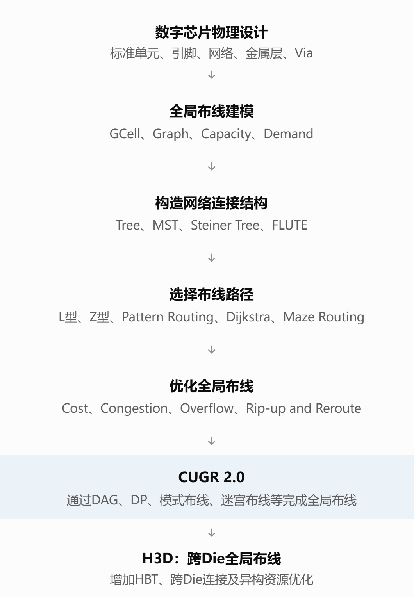
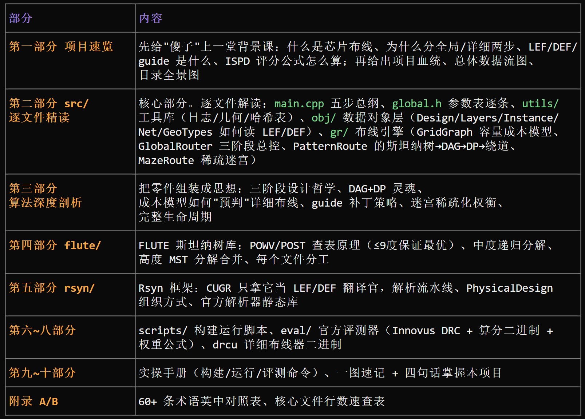

# CUGR 2.0 项目完全解读






> 本文档面向零基础读者，目标是把本项目从"是干什么的"到"每一段代码在做什么"全部讲清楚。
> 文中所有英文术语（English term）在出现处都用括号标注了中文翻译；文件名、代码标识符（identifier）保持原文不译。
> 阅读顺序建议：第一部分 → 第二部分 → 第三部分，其余部分按需查阅。

---

# 第一部分 项目速览：它到底是什么

## 1.1 一句话说明

**CUGR 2.0 是一个芯片"全局布线器"（global router，全局布线器）**：输入一份芯片电路的网表（netlist，网表）和工艺信息，输出一份"布线指南"（routing guide，布线指南/导航文件），告诉后续的"详细布线器"（detailed router，详细布线器）每条电线大致应该走哪条路、走哪几层金属。

它由香港中文大学（CUHK, The Chinese University of Hong Kong）Evangeline F. Y. Young 教授团队开发，是 DAC 2023 论文 **《EDGE: Efficient DAG-Based Global Routing Engine》**（EDGE：基于高效有向无环图的全局布线引擎）的官方配套代码，也是 CUGR 1.0（ICCAD 2019 竞赛冠军工具）的继任者。

## 1.2 零基础背景课（看不懂这些就没法看懂项目）

### 1.2.1 芯片为什么要"布线"

一颗芯片（chip）里有几亿个晶体管（transistor，晶体管），它们被封装成一个个"标准单元"（standard cell，标准单元/门）和"宏模块"（macro，宏模块）。这些单元的引脚（pin，引脚）之间需要按照电路设计用金属线连起来，芯片才能工作。给这些引脚连线的过程就叫 **布线（routing）**。

金属线是画在芯片的多个 **金属层（metal layer，金属层）** 上的（现代工艺有 5~13 层），相邻两层之间靠 **通孔（via，通孔）** 垂直连接。每层金属有一个 **优先走线方向（preferred routing direction，优先走线方向）**：比如第一层金属水平（horizontal，水平）走线、第二层垂直（vertical，垂直）走线，交替轮换。

### 1.2.2 为什么布线要分两步

几亿根线一次算完不现实，所以工业界把布线拆成两步：

1. **全局布线（global routing，全局布线）** —— 本项目做的事。
   把芯片表面划分成一张粗网格，每个格子叫 **GCell（global cell，全局布线单元格）**。全局布线只决定"每条网线（net，网线/信号线）依次穿过哪些 GCell、用哪些金属层"，不决定线在格子里的精确位置。输出是一份 **布线指南（routing guide）**：每条 net 对应一串矩形区域（层 + 坐标范围）。
2. **详细布线（detailed routing，详细布线）** —— 由别的工具做（本项目用 Dr. CU）。
   在 guide 限定的范围内，把每根线的精确坐标、精确轨道（track，走线轨道）、通孔位置定下来，并满足所有 **设计规则（design rule，设计规则）**，比如最小间距（spacing）、最小线宽（width）、最小面积（min area，最小面积）等。违反设计规则叫 **DRC 违规（DRC violation, Design Rule Check violation，设计规则检查违规）**。

打个比方：全局布线像规划"从北京到上海走哪条高速、经过哪些城市"，详细布线像规划"在高速的哪条车道上开、在哪个出口变道"。

### 1.2.3 输入输出文件格式

| 缩写  | 全称（中文）                           | 作用                                                                    |
| ----- | -------------------------------------- | ----------------------------------------------------------------------- |
| LEF   | Library Exchange Format（库交换格式）  | 描述工艺信息：金属层、通孔、设计规则、标准单元/宏的引脚形状与障碍物     |
| DEF   | Design Exchange Format（设计交换格式） | 描述具体电路：有哪些单元实例、摆放在哪、有哪些 net、每个 net 连哪些引脚 |
| guide | routing guide（布线指南文件）          | 全局布线的输出：每条 net 允许占用的层+矩形区域列表                      |
| DBU   | Database Unit（数据库单位）            | 坐标使用的整数单位，例如 1 微米（micron/μm）= 2000 DBU                 |
| GCell | global cell（全局布线单元格）          | 全局布线划分的网格格子                                                  |
| track | routing track（走线轨道）              | 每层金属上金属线可以对齐的等距轨道，轨道间距叫**pitch（节距）**   |

### 1.2.4 怎么评价全局布线的好坏（评分公式）

CUGR 2.0 面向 ISPD 2018 / ISPD 2019 全球布线竞赛（contest，竞赛）的评分标准。以 ISPD19 为例，总分 =

`0.5×线长 + 4.0×单切割通孔数 + 2.0×多切割通孔数 + 各类"出guide/出轨道/错方向"惩罚 + 500×DRC 违规数`

**分数越低越好**。其中最关键的是：只有"详细布线之后 DRC 干净"的 guide 才是好 guide。所以 CUGR 2.0 的设计哲学是 **detailed-routability-driven（以详细布线可达性为驱动）**——它的一切成本模型都在模拟"详细布线器会不会难做"。

### 1.2.5 几个核心算法名词（先混个眼熟，第三、四部分细讲）

| 英文（中文）                           | 一句话解释                                                                                  |
| -------------------------------------- | ------------------------------------------------------------------------------------------- |
| Steiner tree（斯坦纳树）               | 把一条 net 的所有引脚用最短总长度连起来的树状结构                                           |
| RSMT                                   | Rectilinear Steiner Minimal Tree（直角斯坦纳最小树），边只能横平竖直的斯坦纳树              |
| FLUTE                                  | Fast Lookup Table based Wirelength Estimation（基于快速查表的线长估计库），第三方斯坦纳树库 |
| MST                                    | Minimum Spanning Tree（最小生成树）                                                         |
| DAG                                    | Directed Acyclic Graph（有向无环图），本项目的核心数据结构                                  |
| pattern routing（模式布线）            | 只用 L 形/Z 形等固定"模式"连接两点的快速布线                                                |
| maze routing（迷宫布线）               | 在网格图上跑最短路算法绕开障碍的布线，慢但灵活                                              |
| rip-up & reroute（拆线重布，简称 RRR） | 把造成拥塞的线拆掉重新布的迭代策略（CUGR 1.0 用，2.0 改用三阶段流程）                       |
| congestion（拥塞）                     | 某条网格边"想过的线"多于"能过的线"，即车多路窄                                              |
| capacity（容量）                       | 一条网格边最多能过几根线（=轨道数）                                                         |
| demand（需求）                         | 目前已经分配给这条边的线数                                                                  |
| overflow（溢出）                       | 需求 − 容量 > 0 的边，全局布线要尽量避免                                                   |
| DP                                     | Dynamic Programming（动态规划）                                                             |

## 1.3 项目血统

```
CUGR 1.0 (ICCAD 2019 竞赛冠军, 基于 rip-up & reroute 拆线重布)
   └── CUGR 2.0 (本项目, DAC 2023 论文 EDGE 的代码)
        核心变化：用"三阶段 DAG 布线"代替多轮拆线重布迭代，
        更快、质量更好。本代码版本支持 ICCAD'19 基准（benchmark，基准测试）。
```

## 1.4 总体架构与数据流（先看个大概）

```
 X.input.lef ─┐
              ├─► [rsyn/ 框架] 解析 LEF/DEF ──► [src/obj] 自有数据结构(Design)
 X.input.def ─┘                                        │
                                                       ▼
                                        [src/gr] GridGraph(网格图:容量/成本)
                                                       │
              ┌────────────────────────────────────────┤
              ▼                                        ▼
   阶段1: PatternRoute (模式布线)            所有 net 各布一棵带层信息的树
              │ 产出有溢出(overflow)的 net 列表
              ▼
   阶段2: PatternRoute + constructDetours (带绕道的模式布线)
              │ 仍有溢出的 net 列表
              ▼
   阶段3: MazeRoute (稀疏网格上的迷宫布线) + PatternRoute 层分配
              │
              ▼
     生成 guide（含引脚补丁/线段补丁）──► X.solution.guide
              │
              ▼
     [drcu 二进制] Dr. CU 详细布线 ──► X.solution.def
              │
              ▼
     [eval/] Innovus 查 DRC + 官方算分器 ──► eval.score.rpt
```

整个工程由 5 个部分组成，一张表说清各自的角色：

| 目录/文件      | 角色           | 一句话                                                            |
| -------------- | -------------- | ----------------------------------------------------------------- |
| `src/`       | **主角** | CUGR 2.0 自己的 C++ 源码（约 7500 行），编译出可执行文件`route` |
| `flute/`     | 外聘专家       | FLUTE 3.1 斯坦纳树库（C 语言），负责给每条 net 生成初始连接拓扑   |
| `rsyn/`      | 翻译官         | Rsyn 框架裁剪版，负责把 LEF/DEF 文本解析成内存对象                |
| `scripts/`   | 施工队         | Python 脚本：编译、跑测试、画拥塞热力图、性能分析                 |
| `eval/`      | 裁判           | ISPD18/19 竞赛官方评测器（脚本+二进制+权重文件）                  |
| `drcu`       | 下游工具       | Dr. CU v4.1.1 详细布线器（预编译二进制，约 9MB）                  |
| `README.md`  | 说明书         | 项目简介、编译方法、依赖、许可证（license，许可证）               |
| `.gitignore` | 杂项           | git 忽略清单（build/、run*/ 等编译产物目录）                      |

## 1.5 目录结构全景图

```
cu-gr-2/
├── README.md                  # 项目说明
├── drcu                       # Dr. CU 详细布线器二进制
├── src/                       # ★ CUGR 2.0 核心源码
│   ├── CMakeLists.txt         # 构建配置
│   ├── main.cpp               # 程序入口
│   ├── global.h               # 全局头文件 + 命令行参数 Parameters
│   ├── utils/                 # 工具库（日志/几何/打印/哈希表/枚举）
│   │   ├── utils.h            #   汇总头
│   │   ├── log.h / log.cpp    #   带时间戳的日志、计时、内存统计
│   │   ├── geo.h              #   几何模板：点/区间/矩形/线段
│   │   ├── prettyprint.h      #   STL 容器直接 cout 打印
│   │   ├── enum.h             #   Better Enums 第三方枚举库
│   │   └── robin_hood.h       #   robin_hood 快速哈希表
│   ├── obj/                   # 数据对象层（电路信息的自有表示）
│   │   ├── Design.h/.cpp      #   设计总装：读LEF/DEF、层/实例/网线/障碍
│   │   ├── Layers.h/.cpp      #   MetalLayer：金属层+轨道+设计规则
│   │   ├── Instance.h/.cpp    #   Macro(特定朝向的宏)/Instance(实例)
│   │   ├── Net.h/.cpp         #   Net(网线)/PinReference(引脚引用)
│   │   └── GeoTypes.h/.cpp    #   BoxOnLayer：带层号的矩形
│   └── gr/                    # ★★ 布线引擎层（论文本体）
│       ├── GlobalRouter.h/.cpp  #  总控：三阶段流程、guide生成
│       ├── GridGraph.h/.cpp     #  3D网格图：容量/需求/成本模型
│       ├── GRNet.h/.cpp         #  布线视角的 net（含引脚接入点）
│       ├── GRTree.h/.cpp        #  GRPoint/GRTreeNode：布线结果树
│       ├── PatternRoute.h/.cpp  #  模式布线：斯坦纳树+DAG+DP+绕道
│       └── MazeRoute.h/.cpp     #  迷宫布线：稀疏图+多源最短路
├── flute/                     # FLUTE 3.1 斯坦纳树库（C）
│   ├── flute.h / flute.c      #   核心：低度查表+中度递归分解
│   ├── flute_mst.c            #   高度 net：MST 分解合并
│   ├── mst2.c, neighbors.c, heap.c, dist.c, dl.c, err.c, memAlloc.c  # 工具
│   ├── POWV9.dat / POST9.dat  #   ≤9 度 net 的最优解查找表（约9MB）
│   └── Readme, ChangeLog.txt, license.txt
├── rsyn/                      # Rsyn 框架裁剪版（LEF/DEF 解析前端）
│   ├── src/rsyn/              #   session/core/phy/io/ispd18/util 等
│   ├── include/lef5.8 def5.8  #   官方 LEF/DEF 解析器头文件
│   └── lib/linux/             #   liblef.a / libdef.a 预编译静态库
├── scripts/                   # Python 工具脚本
│   ├── build.py               #   一键构建
│   ├── run.py + run_base.py   #   跑 benchmark、评测、查看版图
│   ├── visualize_heatmap.py   #   拥塞热力图可视化
│   └── gprof2dot.py           #   gprof 输出转调用图（第三方）
└── eval/                      # 官方评测器
    ├── ispd18eval/            #   ISPD 2018 评测包
    └── ispd19eval/            #   ISPD 2019 评测包
```

---

# 第二部分 src/ 逐文件精读（CUGR 2.0 本体）

## 2.1 程序入口与全局配置

### 2.1.1 `src/main.cpp`（25 行）——程序入口

整个程序的主流程只有 5 步，是理解全项目的"总纲"：

```cpp
int main(int argc, char* argv[]) {
    Parameters parameters(argc, argv);   // 1. 解析命令行参数
    Design design(parameters);           // 2. 读入 LEF/DEF，建数据结构
    GlobalRouter globalRouter(design, parameters);  // 3. 建全局布线器(含网格图)
    globalRouter.route();                // 4. 执行三阶段布线
    globalRouter.write();                // 5. 输出 guide 文件
}
```

对应命令行用法：

```bash
./route -lef xxx.lef -def xxx.def -output xxx.solution.guide -threads 8
```

### 2.1.2 `src/global.h`（100 行）——全局头文件 + 参数表

做了三件事：

**(1) 引入 STL / Boost / Rsyn 头文件。** 其中 Boost 用到：

- `boost::geometry`（几何库）+ `rtree`（R树空间索引）：定义了 `boostPoint`/`boostBox`/`RTree` 类型别名（当前代码里 RTree 实际未被使用，属预留）；
- `boost/icl/split_interval_map.hpp`（区间容器，预留）。

**(2) 引入 `utils/robin_hood.h`** —— 一个高性能开放寻址哈希表（hash map，哈希表），全项目用它代替 `std::unordered_map` 提速。

**(3) 定义 `Parameters` 结构体（参数表）**，这是全项目的"控制面板"，逐条解读：

| 参数                                       | 值     | 含义（中文）                                                                            |
| ------------------------------------------ | ------ | --------------------------------------------------------------------------------------- |
| `lef_file` / `def_file` / `out_file` | 命令行 | 输入 LEF/DEF 路径、guide 输出路径                                                       |
| `threads`                                | 1      | 线程数。**注意：会被解析和打印，但代码里从未使用**——本 DAC 论文版本是单线程实现 |
| `weight_wire_length`                     | 0.5    | 线长（wire length）在总成本中的权重（对应 ISPD19 评分公式的 0.5×线长）                 |
| `weight_via_number`                      | 4.0    | 通孔（via）在总成本中的权重（对应单切割通孔 4.0 的罚分）                                |
| `weight_short_area`                      | 500.0  | 短路面积（short area，即 DRC 违规区域）的权重（对应 500×违规）                         |
| `min_routing_layer`                      | 1      | 允许布线的最低金属层下标（0=Metal1 只用于接引脚，1=Metal2 起才是正式布线层）            |
| `cost_logistic_slope`                    | 1.0    | 模式布线成本中 logistic 函数（逻辑斯蒂函数，一种 S 形平滑函数）的斜率                   |
| `max_detour_ratio`                       | 0.25   | 阶段2绕道时，允许的"支线总长度增加量 / 主干长度"上限                                    |
| `target_detour_count`                    | 20     | 阶段2为每条拥塞主干最多生成的候选绕道方案数                                             |
| `via_multiplier`                         | 2.0    | 估算通孔占用布线资源时的放大倍数（悲观估计，详见 2.5.2 节）                             |
| `maze_logistic_slope`                    | 0.5    | 阶段3迷宫布线成本中 logistic 函数的斜率                                                 |
| `pin_patch_threshold`                    | 20.0   | 生成"引脚接入补丁"（pin access patch）的剩余资源阈值                                    |
| `pin_patch_padding`                      | 1      | 引脚补丁向外扩的 GCell 数                                                               |
| `wire_patch_threshold`                   | 2.0    | 生成"线段补丁"（wire patch）的剩余资源阈值                                              |
| `wire_patch_inflation_rate`              | 1.2    | 补丁没打上时阈值的膨胀率（让补丁越来越稀疏）                                            |
| `write_heatmap`                          | false  | 是否输出`heatmap.txt`（拥塞热力图数据）                                               |

命令行解析循环只认识 `-lef`、`-def`、`-output`、`-threads` 四个参数；其余参数（如 `run.py` 会传的 `-rrrIters`，是 CUGR 1.0 的遗留参数）只会打印一句 "Unrecognized arg..." 然后被忽略。

### 2.1.3 `src/CMakeLists.txt`——构建配置（CMake，跨平台编译工具）

要点：

- **C++ 标准**：C++14；项目名 `CUGR`；
- **警告**：只加了一条 `-Werror=return-type`（函数该返回值没返回时直接编译报错）；
- **依赖**：
  - Boost（静态链接，必需组件 `system`、`filesystem`、`program_options`）；
  - LEF/DEF 官方解析器静态库（`rsyn/lib/linux` 下的 `liblef.a`、`libdef.a`，Linux；macOS 对应 `lib/macosx`）；
  - pthread（线程库）；
- **源码收集**：`file(GLOB_RECURSE ...)` 把三处源码全部扫进来：
  1. `rsyn/src/**`（Rsyn 框架）；
  2. `flute/*.c`（FLUTE 库）；
  3. `src/**`（CUGR 自己）；
- **唯一编译目标**：`add_executable(route ...)` —— 所有代码编进一个名叫 `route` 的可执行文件；
- **链接选项**：`-static`（完全静态链接，方便分发）+ `-Wl,--whole-archive -rdynamic -lpthread -Wl,--no-whole-archive`（把 pthread 全量链入并保留动态符号表，避免静态链接 pthread 的经典坑；`-rdynamic` 便于崩溃回溯和性能分析）。文件里留了 TODO：`-static` 理想情况下应只在 release 模式开启（用 AddressSanitizer 内存检查器时需要手动去掉）。
- **头文件搜索路径**：`rsyn/src`、`rsyn/src/rsyn/export`、`rsyn/include`、`flute/`、`src/`。

## 2.2 `src/utils/`——工具库（地基）

### 2.2.1 `utils.h`（6 行）

纯粹的汇总头文件：`#include` 了 `geo.h`、`log.h`、`prettyprint.h`、`enum.h` 四个工具头。别处只要 `#include "utils/utils.h"` 就全有了。

### 2.2.2 `log.h` / `log.cpp`（74+85 行）——日志与计时

提供带时间戳的日志设施，全项目所有输出都走它：

- **`class timer`**：基于 `std::chrono::high_resolution_clock`（高精度时钟）的计时器。`start()` 重置，`elapsed()` 返回已流逝秒数。`operator<<` 把它格式化成 `[   1.234] ` 这样的时间戳前缀。
- **全局 `tstamp` 计时器**：程序启动即开始计时；`log()` 返回一个已写入时间戳的 `std::ostream&`，所以 `log() << "xxx" << std::endl;` 打出来的每行日志都带相对程序启动的时间。
- **`class mem_use`**：内存统计。Linux 下读 `/proc/self/statm` 拿当前常驻内存（RSS, Resident Set Size，常驻内存集）、用 `getrusage` 拿峰值内存；Windows 下用 `GetProcessMemoryInfo`。单位 MB。
- **便捷函数**：`print(a,b,c)`（Python 风格打印，变参模板 variadic template）、`printlog(...)`（带时间戳的 print）、`logeol(n)`（打 n 个空行）、`loghline()`（打分隔线）、`logmem()`（打当前/峰值内存）。

### 2.2.3 `geo.h`（400 行）——几何模板库（点/区间/矩形/线段）

这是全项目几何计算的地基，全部是模板类（template class，泛型类），坐标类型 `T` 可以是 `int`（GCell 网格坐标）或 `DBU`（实际物理坐标）。

**(1) `PointT<T>`——二维点**

- 成员 `x, y`；默认构造为"无效点"（取类型最大值/无穷），`IsValid()` 判断是否有效；
- `operator[](d)`：`d=0` 取 x，`d=1` 取 y——**这个技巧全项目到处用**，因为"横/竖"被统一抽象成维度下标，同一份代码可以处理两个方向；
- 支持加减、比较、流输出；
- 三个距离函数：`Dist`（曼哈顿距离 Manhattan distance，|Δx|+|Δy|）、`L2Dist`（欧氏距离 Euclidean distance）、`LInfDist`（切比雪夫距离，取 max）。

**(2) `IntervalT<T>`——闭区间 [low, high]**

- 默认构造为"无效区间"（low=最大值，high=最小值），`IsValid()` 即 `low<=high`；`IsStrictValid()` 要求严格小于（排除退化成一个点的情况）；
- `center()`/`range()`：中点/长度；
- `Update(v)`/`FastUpdate(v)`：扩张区间以包含 v（前者安全、后者假设已有有效值，少一次比较）；
- 几何运算：
  - `UnionWith`：并集的外包区间；
  - `IntersectWith`：交集（可能无效=不相交）；
  - `HasIntersectWith`/`HasStrictIntersectWith`：是否相交；
  - `ParaRunLength`：**平行重叠长度**（parallel run length）——两区间重叠多少，用于估计平行走线间距；
  - `Contain`/`StrictlyContain`：是否包含某值；
  - `GetNearestPointTo(v)`/`GetNearestPointsTo(intv)`：区间内离 v 最近的点/区间组（钳制 clamp 语义）；
  - `ShiftBy`：整体平移。
- 配套还有区间-点、区间-区间的 `Dist` 函数。

**(3) `BoxT<T>`——轴对齐矩形（x 区间 × y 区间）**

- 快捷访问：`lx()/ly()/hx()/hy()`（四边）、`cx()/cy()`（中心）、`width()/height()`、`hp()`（half perimeter，半周长=宽+高，**HPWL 半周线长**就是用它算的）、`area()`；
- `operator[](i)`：取 x 或 y 区间；
- 几何运算与 `IntervalT` 一一对应（并/交/包含/最近点/平移/平行重叠长度），还有 box-box、box-point 的三种距离。

**(4) 两个矩形批处理算法**：

- **`MergeRects(boxes, mergeDir)`**：沿 mergeDir 方向把"对齐且相接/重叠"的矩形合并。做法：按另一方向排序后扫一遍，能并则并。
- **`SlicePolygons(boxes, sliceDir)`**：把一组矩形沿 sliceDir 方向"切片再缝合"，等价于把矩形集合规范化成互不重叠的矩形划分。做法：收集所有矩形边作为切线位置 → 每个矩形按切线切开 → 沿 sliceDir 合并 → 沿 sweepDir 再合并。注释里明说"暴力实现但小规模下够快"。
  （这两个函数在当前布线主流程中未被调用，属于保留的几何工具。）

**(5) `SegmentT<T>`——线段**（继承 `BoxT`）：`length()`=半周长；`IsRectilinear()` 判断是否水平或垂直。

### 2.2.4 `prettyprint.h`（256 行）——STL 容器直接打印

第三方风格的"容器美化打印"库。核心手法：在 `namespace std` 里塞了一个 `operator<<` 模板重载，并用 **SFINAE**（Substitution Failure Is Not An Error，替换失败不是错误，一种模板元编程技巧）检测类型有没有 `begin()/end()`（即是不是容器）。效果是 `std::cout << std::vector<int>{1,2,3}` 直接输出 `1 2 3`，调试时非常方便。还支持自定义分隔符（`custom_delims`）和 `to_string_with_precision`（定点精度转字符串）。

### 2.2.5 `enum.h`（1212 行）——Better Enums 第三方库

开源库 **Better Enums**（BSD 许可证，作者 aantron）：一堆预处理器宏（preprocessor macro），让 C++ 枚举（enum）支持反射（reflection）——可以拿到枚举值的名字字符串、个数、遍历等。项目里 Rsyn 用它定义各种枚举（如层类型、朝向）。

### 2.2.6 `robin_hood.h`（2529 行）——高性能哈希表

开源的 **robin_hood unordered_map/set**（Martin Ankerl 实现）：基于 **Robin Hood hashing**（罗宾汉哈希，一种开放寻址哈希策略："富者让路给贫者"，让探测距离的方差最小化）+ 扁平内存布局的哈希表，比 `std::unordered_map` 快好几倍。项目里所有 `robin_hood::unordered_map` / `unordered_set` 都来自它（例如按 cell 哈希存接入点、按名字存宏索引）。

## 2.3 `src/obj/`——数据对象层（把电路搬进自己的世界）

这一层的任务：**用 Rsyn 解析完 LEF/DEF 后，把需要的数据一次性拷贝成自己的轻量结构**，之后布线引擎不再碰 Rsyn。

### 2.3.1 `GeoTypes.h/.cpp`（24+21 行）——带层号的矩形

- `getBoxFromRsynBounds()`：把 Rsyn 的 `Bounds`（边界类）转成自己的 `BoxT<DBU>`。
- **`class BoxOnLayer : public BoxT<DBU>`**：矩形 + `layerIdx`（所在金属层下标）。这是描述引脚形状、障碍物的基本单元。
- `isConnected(rhs)`：两矩形**层号差 ≤1 且平面相交**就算"相连"（同层直接搭接，或相邻层可通过通孔连接）。

### 2.3.2 `Layers.h/.cpp`（53+106 行）——金属层 `MetalLayer`

把 LEF 里的一个 ROUTING（布线）类型金属层和它对应的 DEF TRACKS（轨道定义）合并抽象出来：

**成员信息**：

- 基本：`name`（层名）、`index`（在布线层中的相对序号）、`direction`（方向，`H=0` 水平 / `V=1` 垂直）、`width`/`minWidth`（线宽/最小线宽）；
- 轨道：`firstTrackLoc`/`lastTrackLoc`（首末轨道位置）、`pitch`（轨道节距）、`numTracks`（轨道数）；
- **设计规则**（注释明言"未完整解析"，够用就行）：
  - `minArea`（最小面积规则）→ 推出 `minLength = max(minArea/width − width, 0)`（一段线为了满足最小面积至少要多长）；
  - **平行走线间距表**（parallel run spacing table）：`parallelWidth`×`parallelLength` → `parallelSpacing` 二维表，表示"线宽 w、平行长度 l 的两条线至少要隔多远"；
  - `defaultSpacing`（默认间距）= 本层常规线宽对应的间距；
  - **线端间距**（end-of-line spacing, EOL spacing，线端间距）：`maxEolSpacing`/`maxEolWidth`/`maxEolWithin`，取所有 EOL 规则的最悲观值（pessimistic，保守取最大）。

**关键方法**：

- `getTrackLocation(trackIndex)`：第 i 条轨道的物理坐标 = 首轨道 + i×节距；
- **`rangeSearchTracks(locRange, includeBound)`**：给定物理坐标范围，返回覆盖该范围的轨道下标区间（用 ceil/floor 除以节距算出）；`includeBound=false` 时把恰好压在边界上的轨道排除。这是网格图计算容量的基础；
- `getParallelSpacing(width, length)`：查二维间距表（从宽端往下找第一个 < width 的行）。

构造函数末尾 `delete rsynLayer.getLayer();` 是释放官方 LEF 解析器返回的 C 对象，防止内存泄漏（memory leak，内存泄漏）。

### 2.3.3 `Instance.h/.cpp`（44+77 行）——宏 `Macro` 与实例 `Instance`

**`class Macro`**：注意它的定义——"**一个特定朝向（orientation，放置朝向）的宏**"。同一个 LEF 宏（如某个 SRAM）以 N/E/S/W/翻转等 8 种朝向摆放时，引脚形状的相对位置不同，所以 CUGR 把 (宏名, 朝向) 的每种组合都建成一个独立 `Macro`，预先算好它内部的：

- `pins`：每个信号引脚（signal pin，非电源地的引脚）的所有矩形形状（`BoxOnLayer` 列表）。构造时把 LEF 中的引脚几何（pin geometry）经原点平移（translate）+ 朝向变换（transform.apply）算好；
- `obstacles`：宏内部所有布线障碍（包括引脚形状本身也当障碍——别的线不能走）+ LEF OBS（obstruction，障碍物）段里 ROUTING 层的矩形；
- `pinIndices`：引脚名→下标的映射，`getPinIndex(name)` 查询用。

**`class Instance`**：设计里的一个具体摆放物，两类：

- `CELL`（单元实例）：名字 + `macroIndex`（指向哪个 Macro）+ `position`（摆放位置）；
- `PORT`（IO 端口，芯片对外的引脚）：直接存一个 `BoxOnLayer`（端口的物理矩形，构造时同样做了朝向变换）。

`isCell()` 区分两类。设计层用 `instances` 数组统一存放（下标即身份）。

### 2.3.4 `Net.h/.cpp`（27+1 行）——网线 `Net`

极简：

- **`struct PinReference`**（引脚引用）= `{instanceIndex, pinIndex}`：指向"哪个实例的哪个引脚"。端口（PORT）的 `pinIndex = -1`；
- **`class Net`** = 下标 + 名字 + `vector<PinReference> pinRefs`（这条 net 连的所有引脚）。

`Net.cpp` 只有一行 `#include "Net.h"`——全部实现都在头文件内联了。

### 2.3.5 `Design.h/.cpp`（53+273 行）——设计总装（本层核心）

`Design` 构造函数只做两件事：`read(lef, def)` + `setUnitCosts()`。

**`read()` 的五个步骤**（对应源码注释 1~5）：

0. **启动 Rsyn**：`Rsyn::ISPD2018Reader reader; reader.load({{"lefFile",...},{"defFile",...}})`，然后拿到 `Rsyn::PhysicalDesign`（物理设计对象）、顶层模块（top module）。记录 `libDBU`（库 DBU）和 `dieRegion`（芯片核心区域 die area，裸片区域）。
1. **提取金属层**：遍历所有物理层，ROUTING 类型的建成 `MetalLayer` 存入 `layers`（CUT 即通孔层类型跳过）。
2. **提取宏与实例**：遍历所有实例：

   - 是 CELL：算 `macroHash = 宏名下标 × 朝向总数 + 朝向`——相同 (宏,朝向) 组合复用同一个 `Macro`（首次出现才构造）；然后建 `Instance`；
   - 是 PORT：直接建端口型 `Instance`。
     同时维护 `instanceIndices`（实例名→下标）。
3. **提取网线**：遍历所有 net，**跳过 POWER/GROUND（电源/地）**。对每个引脚：端口引脚按名字找实例下标（pinIndex=-1）；单元引脚则先找实例、再用 `Macro::getPinIndex` 找到宏内引脚下标，组成 `PinReference`。
4. **提取特殊网线（special net，即电源/地网络）作为障碍**：这是最复杂的一段。遍历每个 special net 的每段 wire（走线）：

   - 对连续两个布线点（routing point），确定走线方向维度，用线宽（`clsRoutedWidth`）和端点延伸（extension）构造矩形障碍；
   - 若点上带通孔（`clsHasVia`）：找到 via 定义，把它的**下层几何**（bottom geometries）、**上层几何**（top geometries）逐个平移到通孔位置加为障碍；如果是由 **via rule（通孔生成规则）** 生成的阵列通孔，还要根据行列数（row/col）、切割尺寸（cut size，切割孔尺寸）、间距（spacing）、包覆（enclosure，通孔上下金属比切割孔多出的一圈）手工算出上下层的外包矩形加为障碍；并相应切换当前层号继续追踪走线。
5. **生成 GCell 网格线（gridlines）**：

   - 若 DEF 里有 `GCELLGRID` 定义：按它的 location/step/numTracks 生成两个方向的网格线，再补上 die 边界并排序；
   - 若没有：按 `defaultGridlineSpacing = 3000` DBU 等间距切分 die 区域。

最后打印设计统计（单元数/端口数/net 数/特殊 net 数/网格规模 x×y×层数）。

**`setUnitCosts()`——把评分权重换算成单位成本**：

- `unit_length_wire_cost = weight_wire_length / m2_pitch`（以 M2 节距为单位的线长单价——这样算出来的线长成本和评分公式同量纲）；
- `unit_via_cost = weight_via_number`；
- `unit_length_short_costs[l] = (weight_short_area / m2_pitch²) × 层宽`：**单位长度短路成本**。含义是"一段线如果造成短路违规，违规面积 ≈ 长度×宽度，罚分 500×面积"，摊到单位长度上就是每层一个常数。这是把 DRC 违规折算进布线成本的关键一步。

**对外服务**：

- `getPinShapes(pinRef, out)`：把一个引脚引用解析成绝对坐标下的矩形列表（宏内形状 + 实例位置平移；端口直接返回）；
- `getAllObstacles(out, skipM1=true)`：汇总所有障碍到各层（默认跳过 Metal1——因为 M1 不走线，不用扣容量）。

## 2.4 `src/gr/`——布线引擎层（论文本体，全项目心脏）

这一层实现 DAC 2023 论文《EDGE》的全部内容。文件间的依赖关系：

```
GRTree (点/树的基本类型)
  ▲
GRNet (net 的布线视角: 接入点+包围盒)     GridGraph (3D网格图: 容量/成本)
  ▲                                        ▲
  └──────────┬─────────────────────────────┘
       PatternRoute (模式布线: 斯坦纳树→DAG→DP)   MazeRoute (迷宫布线)
             ▲                                       ▲
             └──────────── GlobalRouter (三阶段总控 + guide 生成)
```

### 2.4.1 `GRTree.h/.cpp`（25+14 行）——布线的基本类型

- **`class GRPoint : public PointT<int>`**：三维网格点 `(layerIdx, x, y)`——层号 + GCell 行列。
- **`class GRTreeNode : public GRPoint`**：带 `children`（shared_ptr 智能指针子节点列表）的树节点。**一条 net 的最终布线结果就是一棵以 GRTreeNode 为节点的树**：同层相邻节点间是 wire（走线段），同 (x,y) 不同层的节点间是 via（通孔）。
- `preorder(node, visit)`：前序遍历（preorder traversal）工具，全项目统计/提交需求时反复使用；
- `print(node)`：调试打印树结构。

### 2.4.2 `GRNet.h/.cpp`（27+54 行）——布线视角的 net

把 `obj` 层的 `Net` 转成布线引擎用的形式，核心是**引脚接入点（access point，接入点）**：

构造函数对每个引脚：

1. `design.getPinShapes()` 拿到引脚的所有物理矩形；
2. `gridGraph.rangeSearchCells()` 找出每个矩形覆盖的所有 GCell；
3. 每个被覆盖的 GCell 生成一个 `GRPoint`（引脚所在层, x, y），用 `hashCell` 去重后存入 `pinAccessPoints[pinIndex]`。

**含义**：一个引脚可能横跨多个 GCell、有多个矩形，布线时可以从其中任何一个 GCell 接入它——候选集合就是 `pinAccessPoints`。同时维护 `boundingBox`（所有接入点的网格包围盒，用于 net 排序）。

### 2.4.3 `GridGraph.h/.cpp`（142+569 行）——三维网格图：容量、需求与成本模型

这是全局布线的"地图"。

**(1) 基本类型与成员**

```cpp
struct GraphEdge { CapacityT capacity; CapacityT demand; }  // 容量与需求
```

- 每条网格边（grid edge）记录容量（capacity，能过几根线）和已用需求（demand，已分配几根线）；`getResource()` = capacity − demand 即**剩余资源（resource）**。剩余资源 < 0 就是溢出（overflow）。
- `graphEdges[layer][x][y]` 存的是**从 (x,y) 沿该层优先方向指向下一个 GCell 的那条边**（水平层存右向边，垂直层存上向边）——所以网格图本质上是"每个 GCell 只存一条出边"的紧凑表示。

**(2) 构造函数：初始化容量**（难点，分两步）

*第一步：无障碍容量 = 轨道数。* 对每层，先算每个 GCell 行/列里有多少条轨道（`rangeSearchTracks`，且排除压在高侧网格线上的那条轨道避免两边重复计数），这个轨道数就是该方向所有网格边的初始容量。

*第二步：扣掉障碍物占用的容量（Metal2 及以上）。* 这是全文件最硬核的一段（约 90 行）：

1. 每个障碍物先按**间距裕量**膨胀：`spacing = 平行间距表查得的间距 + 层宽/2 − 1`，膨胀只发生在垂直于走线方向的维度上（因为沿走线方向不挡别的线）；
2. 算出膨胀后障碍覆盖的轨道范围和被它挡住的 GCell 行/列，把障碍挂到这些 track grid（轨道格子）上；
3. 对每个 track grid、每条网格边：假设边上有 N 条轨道，每条轨道初始是"可用区间"（边的两个 GCell 中心之间）；逐个障碍裁剪这些区间（完全横跨网格线的→区间缩成 0；只挡一部分→截断一端）；
4. **最终容量 = Σ 每条轨道剩余可用长度 / 边长**——所以容量是浮点数（`CapacityT = double`），例如障碍挡住某条轨道一半，容量就少 0.5。

这种"按可用区间比例计容量"的精细建模，让全局布线的容量非常接近详细布线的真实可布性——这是 CUGR 系列质量高的重要原因。

**(3) 成本模型（cost model）——把评分公式揉进图里**

- **`logistic(input, slope) = 1/(1+e^(input·slope))`**：S 形平滑函数。当剩余资源充足时趋近 0（几乎不罚），剩余资源变负（溢出）时趋近 1（全额罚）。用它代替硬阈值，让成本对拥塞"渐进而非突变"，布线器能平滑地避开拥挤区域。
- **`getWireCost(layer, lower, demand=1)`**（单条边的走线成本）：

  ```
  成本 = demand长度 × 单位线长成本
       + demand长度 × 单位短路成本 × (容量<1 ? 1 : logistic(容量−需求, slope))
  ```

  即：**基础线长费 + 按拥塞程度平滑加权的短路风险费**。容量 < 1（整条边几乎被障碍堵死）时直接罚满。
- `getWireCost(layer, u, v)`：沿 u→v 逐边累加。
- **`getViaCost(layer, loc)`**（在 loc 处打 layer→layer+1 通孔的成本）：

  ```
  成本 = 单位通孔成本
       + 上下两层各估算一笔"为满足最小面积规则需额外走的线"的成本
  ```

  具体：通孔在上下两层各占掉相邻两条边的部分资源，占用量 = `层最小长度 / (两边总长) × via_multiplier(=2)`，再按 `getWireCost` 折算成成本。**把通孔的最小面积（min-area）代价显式建模**是 CUGR 的特色。

**(4) `selectAccessPoints(net, out)`——为每个引脚选定唯一接入点**

一条 net 的每个引脚有一堆候选接入点，造斯坦纳树前必须每个引脚选一个。选择标准（贪心 greedy，两级）：

1. **可接入性（accessibility，可接入性）优先**：接入点所在层 ≥ 最低布线层时，检查它沿优先方向的左右两条边容量是否 ≥1（各加 1 分，满分 2）；层太低的（M1 引脚）直接给 1 分；
2. **同分比距离**：离 net 包围盒中心曼哈顿距离近者胜。

选完后把同一 (x,y) 格内多个引脚的接入点合并，并记录该格的 **`fixedLayers`（固定层区间）**：这些引脚的所有接入层构成的区间。最后**把区间上限再抬高 2 层**——方便布线时换层（track switching，轨道切换），这是给后续层分配留的灵活性。这个"固定层区间"会一路传到斯坦纳树节点和 DAG 节点上，约束层分配（引脚必须能被接到）。

**(5) 需求提交与溢出检查**

- `commit / commitWire / commitVia(layer, loc, reverse)`：给边加需求（`reverse=true` 即减需求=拆线 rip-up）。通孔的提交与成本估算同构：上下两层相邻边各加"最小面积分摊"的需求，并维护 `totalNumVias`。
- **`commitTree(tree, reverse)`**：前序遍历一棵布线树，同层边逐段 commit wire，跨层边逐层 commit via。全局布线器每布好/拆掉一条 net 就调它一次，保持 demand 实时同步。
- `checkOverflow(...)`：三个重载——单条边、一条线段、整棵树（只查 wire 不查 via），返回溢出边数。

**(6) 二维视图（2D view）——给阶段 2/3 的简化地图**

**`template <typename Type> class GridGraphView`**：一个 `[方向][x][y]` 的三维数组（把多层同方向的边压成一张 2D 图），带两个工具：

- `check(u, v)`：u→v 线段上是否有任何一条边为 true（用于查拥塞）；
- `sum(u, v)`：u→v 线段上所有边值之和（用于累计成本）。

三个提取函数：

- `extractBlockageView`：`view[dir][x][y] = 是否没有任何一层容量≥1`（全堵死才算 blockage，当前未使用）；
- **`extractCongestionView`**：`view[dir][x][y] = 是否有任何一层溢出`——阶段 2 绕道用它找"哪里堵了"；
- **`extractWireCostView`**：`view[dir][x][y] = 边长 × (单位线长成本 + 最小单位短路成本 × logistic(总容量−总需求, maze_slope))`——把同方向所有层的容量/需求加总后算 2D 成本，阶段 3 迷宫布线的边权。`updateWireCostView` 则只增量更新一棵刚布好的树影响到的边。

**(7) 其他**

- `rangeSearchGridlines / rangeSearchRows`：物理坐标区间 → 网格线下标区间 / GCell 行列区间（二分查找 binary search）；
- `getCellBox / rangeSearchCells`：GCell 下标 ↔ 物理矩形互转；
- `getEdgeLength(dir, i)`：相邻两 GCell 中心间距（边的物理长度）；
- `getPythonString(tree)`：把布线树导成 Python 字面量格式（可视化调试用）；
- `write(heatmap_file)`：把每层的 (capacity−demand) 矩阵写成 `heatmap.txt`，供 `visualize_heatmap.py` 画图。

### 2.4.4 `GlobalRouter.h/.cpp`（24+337 行）——总控：三阶段流程 + guide 生成

**构造函数**：先建 `GridGraph`（含容量初始化），再把每条 `Net` 包装成 `GRNet`。

**`route()`——论文的核心流程**（下面第三部分还有更深剖析，这里先建立骨架）：

```
阶段1 stage 1: pattern routing（模式布线）
   所有 net 按包围盒半周长升序排序（短 net 先布）
   对每条 net: 建 PatternRoute → 造斯坦纳树 → 造 DAG → DP 求解 → commitTree 提交需求
   找出有溢出的 net → 交给阶段2

阶段2 stage 2: pattern routing with possible detours（带绕道的模式布线）
   提取 2D 拥塞视图 congestionView
   对每条溢出 net: 先 commitTree(reverse=true) 拆掉它
     → 重新造斯坦纳树/DAG → constructDetours(congestionView) 在拥塞处加候选绕道
     → DP 求解 → 提交
   仍溢出的 → 阶段3

阶段3 stage 3: maze routing on sparsified routing graph（稀疏图上的迷宫布线）
   先把所有剩余溢出 net 全拆掉；提取 2D 线成本视图 wireCostView
   稀疏网格 SparseGrid(10,10) 起步
   对每条 net: 建 MazeRoute → 在稀疏 2D 图上跑多源最短路得到新拓扑(斯坦纳树)
     → 把该拓扑塞回 PatternRoute 做 DAG+DP 层分配 → 提交
     → updateWireCostView 增量更新视图；grid.step() 换一个稀疏采样偏移
```

每阶段结束打印"X / N nets have overflows."（还有多少 net 溢出）并计时。

**`sortNetIndices()`**：按 net 包围盒半周长（HP）升序排——短线先布，因为它们选择少、更容易被挤坏。

**`getGuides(net, guides)`——把布线树翻译成 guide 矩形**（输出质量的关键，三部分）：

0. **基础 guide**：遍历布线树，同层边 → 一个矩形（覆盖两端的 GCell 范围）；跨层边 → 从低到高每层一个点矩形（通孔柱）。
1. **引脚接入补丁（pin access patch，引脚接入补丁）**：对位于最低布线层之下的引脚接入点（比如 M1 的引脚）：若在最低布线层上的剩余资源 < `pin_patch_threshold`(20)，则把补丁扩大 `pin_patch_padding`(1) 格；然后从引脚层到 `min_routing_layer+1` 层每层发一块补丁矩形。**作用**：告诉详细布线器"这个引脚周围这几层你都可以用"，避免引脚被围死接不出来。累计面积记入 `areaOfPinPatches`。
2. **线段补丁（wire segment patch，线段补丁）**：沿每段走线逐格检查，若该格剩余资源 < `wire_patch_threshold`(2.0)，尝试在**上下相邻层**（同一格）找剩余资源 ≥1 的层发一个点补丁——给详细布线器一个"此处可以换层逃生"的备选；若这次没打上补丁，阈值 ×= 1.2（`wire_patch_inflation_rate`）膨胀，让后面的补丁越来越难触发（防止补丁泛滥）；打上了则阈值复位。

**`printStatistics()`**：布线结束后统计：总线长（换算成 M2 节距倍数，即评分公式的"线长"量纲）、总通孔数、总溢出量、全图最小剩余资源及瓶颈位置（bottleneck，瓶颈）。

**`write(guide_file)`**：把所有 net 的 guide 按 ISPD 竞赛格式写出：

```
net名字
(
x1 y1 x2 y2 层名
...
)
```

其中坐标用 `getGridline` 把 GCell 下标换回物理坐标（注意 high 端 +1，因为 guide 矩形是 GCell 块的外边界）。

### 2.4.5 `PatternRoute.h/.cpp`（69+679 行）——模式布线：论文的核心引擎

这是《EDGE》论文标题里 **"DAG-Based Global Routing Engine"（基于有向无环图的全局布线引擎）** 的实现。思想：把"一条 net 的所有合理走法"组织成一个 DAG，然后在 DAG 上跑动态规划，一次性求出"拓扑连接 + 层分配"联合最优解。

**三个节点类**：

- **`SteinerTreeNode`**：斯坦纳树节点 = 2D 网格点 (x,y) + `fixedLayers`（固定层区间，仅引脚接入点有）+ children。代表"纯拓扑"，不带层。
- **`PatternRoutingNode`**：DAG 节点 = 2D 网格点 + `index`（节点编号）+ `children`（斯坦纳树意义上的孩子）+ **`paths`（孩子下标 → 候选路径列表）** + `fixedLayers` + DP 用的 `costs`/`bestPaths` + `optional`（是否可选的中间拐点）。注意区分：`children` 是树结构，`paths` 是 DAG 边——连接同一个孩子的路径可以有多条（不同 L 形/绕道），这就是 DAG 比树多的自由度。
- 两个 `getPythonString`：导出调试格式。

**(1) `constructSteinerTree()`——造初始拓扑**

1. 调 `GridGraph::selectAccessPoints` 给每个引脚选定接入点（带 fixedLayers）；
2. 若只有 1 个接入点，树就只有一个节点；否则把接入点坐标喂给 **FLUTE**：`flute(degree, xs, ys, ACCURACY)` 得到一棵 2D 直角斯坦纳树；
3. FLUTE 返回的是"branch 数组 + 父指针"格式（见第四部分），这里转成邻接表（adjacency list，邻接表），挑一个度为 1 的点当根，递归建成 `SteinerTreeNode` 树：
   - 递归中跳过"与父节点同坐标"的退化点（FLUTE 会在引脚处生成重合的斯坦纳点）；
   - 若某节点坐标命中某个接入点，把该接入点的 `fixedLayers` 赋给它（它是引脚，层分配受约束）。

**(2) `constructRoutingDAG()`——把树扩张成 DAG**

递归地把每个斯坦纳树节点复制成一个 `PatternRoutingNode`，然后对每对父子调 `constructPaths(parent, child)`：

- 父子同行或同列：只有一种直连走法，`paths[child] = {child}`；
- 父子不同行也不同列：生成**两条 L 形候选路径**——各经一个中间拐点 `(child.x, parent.y)` 或 `(parent.x, child.y)`，中间点标记为 `optional`（可选节点）并指向 child。

于是 DAG 的"树骨架"固定，但每个树边有 1~2 种走法；DP 将在其中做选择。这就是 stage 1 的解空间。
（文件里 155~287 行有一段被注释掉的旧版 `constructRoutingDAG`，是重构前的实现——接入点选择+斯坦纳树+DAG 三合一，现已被拆成三步，无需理会。）

**(3) `constructDetours(congestionView)`——阶段 2 的绕道生成（最难的一段）**

目标：对阶段 1 后仍溢出的 net，**在拥塞的树边附近生成"平移绕开"的候选路径**，加进 DAG 让 DP 重新选。步骤：

1. **搭脚手架（scaffold，脚手架）**：`buildScaffolds` 递归遍历 DAG，把"在拥塞视图上检查为拥塞的树边"按方向（H/V）聚成若干棵 **ScaffoldNode 树**——每棵代表一条需要绕开的"拥塞主干道"及其连带结构。optional 中间点只起传导作用，不单独成架。
2. **提取主干与支线（trunk & stems，主干与支线）**：`getTrunkAndStems` 对每棵脚手架算出：主干沿走线方向的跨度区间 `trunk`，以及挂在主干上的所有支线端点位置 `stems`（固定层节点和未入架的普通孩子的垂直坐标）。
3. **确定平移候选**：把主干沿垂直方向左右平移。平移多远是有限制的：
   - **绕行代价约束**：新位置导致的"支线总长增加"不能超过 `trunk.range() × max_detour_ratio`(0.25)——用 `getTotalStemLength`（所有支线端点到新位置的距离和）评估；
   - **数量约束**：在允许区间内均匀取点，步长 `step` 保证总候选数 ≈ `target_detour_count`(20) 以内。
4. **生成绕道子树**：`buildDetour` 对每个候选平移量，把脚手架子树整体复制一份并平移（遇到 fixedLayers 节点时保留一个"原位复制节点"用来垂直落回原层接回引脚），再用 `constructPaths` 把平移后的子树挂回原 DAG——作为原树边之外的**额外候选路径**。

最终效果：DAG 里每条拥塞树边多了最多约 20 条"平移绕行"的候选走法，DP 自动权衡"绕远的线长费 vs 不绕的拥塞费"。

**(4) `run()` = `calculateRoutingCosts()` + `getRoutingTree()`——DAG 上的动态规划**

这是论文的算法核心。**问题形式化**：给 DAG 每个节点分配一个"通孔柱区间" `[low, high]`（节点处垂直跨层范围，必须包含该节点的 fixedLayers），并为每条树边选一条候选路径、选一个走线层（必须在父节点的区间覆盖范围内），使总成本（线长+通孔+拥塞罚）最小。

*`calculateRoutingCosts(node)`（自底向上 DP，后序递归）*：

1. 先递归算完所有路径子节点的成本；
2. **`childCosts[child][layer]`**：该孩子子树"在孩子位于 layer 层被连接"时的最小成本 = min over 候选路径（路径子树成本 + 本节点到路径的走线成本），只统计走线方向与 layer 方向一致的层（水平段只能落在水平层，垂直段只能落在垂直层）；
3. **via 成本前缀和** `viaCosts[l]` = 从层 0 打到层 l−1 的所有通孔成本之和（前缀和 prefix sum 让任意区间 [low,high] 的通孔柱成本 = `viaCosts[high]−viaCosts[low]`，O(1) 查询）；
4. **枚举通孔柱区间**：外层枚举 `low ∈ [0, fixedLayers.low]`，内层 `high` 从 low 向上扫，同时维护 `minChildCosts[child]` = 该孩子在 [low, high] 内任意层接入的最小成本（随 high 扩大增量更新）；当 `high ≥ fixedLayers.high` 时，得到一个合法解：

   ```
   node->costs[high] = min( 通孔柱成本(viaCosts[high]−viaCosts[low]) + Σ minChildCosts )
   ```

   并记录每个孩子当时的最优 (路径, 层) 到 `bestPaths[high]`；
5. **回扫松弛**：从顶层往下 `costs[l] = min(costs[l], costs[l+1])`——因为"通孔柱顶在 l+1 层"的解对"顶在 l 层"也合法（少打一层孔即可），取 min 后 `costs[l]` 表示"柱顶至少到 l"的最优。

`node->costs[layer]` 的最终语义：**该子树在本节点通孔柱顶部到达 layer 时的最小总成本**。整个 DP 的复杂度约为 O(节点数 × 层数 × (层数+路径数))，由于层数 ≤ 13 且路径数 ≤ 2+绕道数，非常快——这就是论文宣称高效的原因。

*`getRoutingTree(node, parentLayerIndex)`（自顶向下回溯构造）*：

1. 根节点先取 `costs` 最小的层作为顶部层；
2. 按 `bestPaths[parentLayerIndex][child]` 取出每个孩子选中的 (路径, 层)，把路径按层分桶 `pathsOnLayer`；
3. 在 `parentLayerIndex` 层建 `GRTreeNode`；同层路径直接挂为子树；**低于/高于该层的路径**：先沿垂直方向逐层铺 `GRTreeNode`（形成通孔柱链 `lowestRoutingNode`/`highestRoutingNode`），再挂子树；
4. 最后检查 `fixedLayers`：若通孔柱链没低到 `fixedLayers.low` 或没高到 `fixedLayers.high`，补铺节点——**保证引脚一定能被接到**。

产物就是 `GRNet::routingTree`（一棵带完整层信息的布线树），交给 `GridGraph::commitTree` 提交需求。

### 2.4.6 `MazeRoute.h/.cpp`（89+264 行）——迷宫布线：阶段 3 的重拓扑武器

阶段 2 后仍溢出的 net，说明"L 形/平移绕道"级别的自由度不够，需要**彻底改变拓扑**。但直接在完整 3D 网格上跑迷宫布线太慢，CUGR 2.0 的做法是：**先在稀疏化的 2D 图上迷宫布线得到新拓扑，再交回 PatternRoute 做层分配**。

**(1) `struct SparseGrid`（稀疏网格）**：`interval`（采样间隔，初始 (10,10)）+ `offset`（采样偏移）。`step()` 把 offset +1 并对 interval 取模——每处理一条 net 就换一个偏移，**让不同 net 采样到不同的稀疏网格线**，错开彼此的"盲区"。

**(2) `class SparseGraph`（稀疏图）**：`init(wireCostView, grid)` 建图分 5 步：

0. **伪引脚（pseudo pin，伪引脚）**：`selectAccessPoints` 选定的接入点集合；
1. **收集稀疏网格线**：x 方向 = 所有满足 `i×interval.x + offset.x` 的线 ∪ 所有引脚 x 坐标（引脚处必须有线，否则接不上）；y 同理。去重排序得到 `xs`/`ys`；
2. **加顶点**：每个 (方向 direction ∈ {H,V}, x, y) 组合一个顶点——**用"方向"这一维隐式代表"该走水平层还是垂直层"**，从而把 3D 问题压成 2D；
3. **同层边（same-layer connection，同层连接）**：相邻稀疏线之间的顶点连边，边权 = `wireCostView.sum(u,v)`（该线段在 2D 成本视图上的总成本）；
4. **跨层边（diff-layer connection，跨层连接）**：同一 (x,y) 的 H/V 两顶点互连，边权 = 单位通孔成本（代表换方向≈换层要打孔）；**引脚处的跨层边成本置 0**（引脚接入免费换层）；
5. 建立顶点↔引脚的映射 `vertexPin`/`pinVertex`。

顶点数 = 2×|xs|×|ys|，每点最多 3 条边（前进、后退、换向），存储极省。

**(3) `MazeRoute::run()`——多引脚迷宫布线（连续最短路启发式）**

经典的"逐引脚 Dijkstra 生长"算法：

1. 从引脚 0 出发，用优先队列（priority queue，最小堆）跑 **Dijkstra 最短路**（迪杰斯特拉算法）；`Solution` 记录 (成本, 顶点, 前驱)；`minCosts` 做剪枝（pruning，只扩张更优的解）；
2. 一旦堆顶弹出的解落在某个**未访问引脚**上：把这条路径收进 `solutions`，然后**把路径上所有顶点的成本置 0 重新入堆**——相当于整条已布路径变成新的"源"；
3. 重复直到所有引脚连通（numDetached 归零）。

这样长出来的就是一棵近似斯坦纳树（属于 successive shortest paths heuristic，连续最短路启发式）。

**(4) `getSteinerTree()`——把解路径还原成斯坦纳树**

1. 沿每条 solution 的前驱链回溯，顶点→`SteinerTreeNode`，已建的复用（`created` 表），拼成一棵树；路径两端（必为引脚）打上 `fixedLayers`；
2. **去冗余**：合并"父子同坐标"的节点（fixedLayers 做并集）；
3. **去中间点**：把"无 fixedLayers、只有一个孩子、且与孩子共线"的度-2 节点压缩掉（长直路径只留端点）；
4. 校验无重复节点后返回。

输出的 `SteinerTreeNode` 树随后通过 `PatternRoute::setSteinerTree()` 塞回模式布线器，走 `constructRoutingDAG()` + `run()` 完成层分配——**迷宫负责"往哪走"，DAG 负责"走哪层"**，各司其职。
-------------------------------------------------------------------------------------------------------

# 第三部分 核心算法深度剖析（把第二部分的零件组装成思想）

## 3.1 三阶段总流程：为什么这样设计

传统全局布线器（包括 CUGR 1.0）靠 **rip-up & reroute（拆线重布）** 迭代几十轮来消除溢出，慢且质量不稳。CUGR 2.0 用三个**递进增强**的阶段取而代之，每阶段只处理上一阶段搞不定的 net：

| 阶段          | 解空间自由度                          | 处理对象            | 思想                                                     |
| ------------- | ------------------------------------- | ------------------- | -------------------------------------------------------- |
| 1. 纯模式布线 | FLUTE 拓扑 + L/Z 形 + 全层分配        | 全部 net            | 绝大多数 net 在"最优斯坦纳拓扑 + 最优层分配"下天然不冲突 |
| 2. +绕道      | 阶段1 + 每条拥塞边 ~20 个平移绕行候选 | 阶段1后溢出的 net   | 局部冲突通过"主干平移"绕开，仍保持 DAG+DP 的高效         |
| 3. 迷宫重拓扑 | 彻底换拓扑（稀疏图最短路）+ 层分配    | 阶段2后仍溢出的 net | 极少数硬骨头用最灵活的迷宫布线换一条全新骨架             |

设计哲学：**把最贵的自由度留给最少的 net**。阶段 1 是近似线性复杂度，几秒钟布完几十万条 net；阶段 3 的迷宫布线只作用于百分之几的 net，且图被稀疏化（10 格取 1），代价可控。

## 3.2 FLUTE：初始拓扑从哪来

阶段 1/2 的每条 net 先用 FLUTE 生成 2D 斯坦纳树拓扑。FLUTE（第四部分详述）的核心卖点：**度数 ≤9 的 net 直接查表得最优解**（预计算的 POWV/POST 表），更大的 net 用递归分解/MST 分解合并。芯片里 99% 的 net 度数都很小，所以这一步几乎免费且几乎最优。

## 3.3 DAG + DP：CUGR 2.0 的灵魂

传统做法把"布线"拆成两个串行步骤：先定 2D 拓扑，再做 **layer assignment（层分配）**。串行的缺点是第二步无法回头改第一步的决定。CUGR 2.0 的洞察：

> 把"每个树边的少量候选走法（L 形两选、绕道多选）"和"每个节点的通孔柱区间"统一编码进一个 DAG，则"选路径 + 层分配"变成一个 DAG 上的联合优化问题，且存在高效精确 DP。

DP 状态 `costs[l]`（子树在节点通孔柱顶到 l 层的最小成本）配合"前缀和算通孔柱成本"和"扫描维护区间内最小孩子成本"两个技巧，把原本 O(层数²×孩子) 的枚举压到近似 O(层数×孩子)。**这是论文《EDGE》名字里 "DAG-Based Engine" 的本体**。

## 3.4 成本模型：如何让全局布线"预判"详细布线

1. 评分公式直接编码：`0.5×线长 + 4×通孔 + 500×短路面积` 折算成单位成本（`Design::setUnitCosts`）；
2. 容量精细建模：轨道级 + 障碍按可用区间比例扣减；
3. 拥塞惩罚平滑化：logistic 函数让"快满了"的边成本连续上升，引导后来的 net 提前避让；
4. 通孔代价完整：不只是 4 分本身，还加上它为满足最小面积规则在上下层"附带的线长占用"（×2 悲观系数）。

## 3.5 Guide 补丁：全局与详细之间的"缓冲垫"

全局布线的 guide 越紧，详细布线越容易被困死；越松，又失去指导意义。CUGR 2.0 的折中：**基础 guide 保持紧凑（就是布线树本身），只在"资源紧张"的点主动打补丁**：

- 引脚接入补丁：引脚上方资源 < 20 → 给引脚附近 (2×pad+1)² 的区域、从引脚层到 M3 的"宽松接入空间"；
- 线段补丁：沿线某格资源 < 2 → 在上下层同位置各开一个"逃生窗口"；且用 1.2 倍膨胀率让补丁密度自适应。

统计打印的两个 patch 面积就是用来监控这项开销的。

## 3.6 迷宫布线的"稀疏化"权衡

阶段 3 的 SparseGraph 把完整网格按 10 格取 1 抽样（引脚坐标必保留），顶点数从 O(2·X·Y) 降到约 O(2·(X/10+p)·(Y/10+p))，边权直接用 2D 成本视图在线段上求和——精度损失靠两点弥补：

1. `SparseGrid.step()` 轮换采样偏移，不同 net 的"盲区"错开；
2. 稀疏图只决定拓扑，真正的层与精细走法仍由 DAG+DP 在全分辨率网格上完成。

## 3.7 一次完整执行的生命周期（数据视角）

```
1. main: Parameters 解析命令行
2. Design::read: Rsyn 解析 LEF/DEF → layers/macros/instances/nets/obstacles/gridlines
3. Design::setUnitCosts: 评分权重 → 单位成本
4. GridGraph 构造: gridlines×层 → 每边容量(轨道数−障碍扣减)
5. GRNet × N: 每 net 的引脚 → 候选接入点 GRPoint 集
6. route() 阶段1: 每 net
     selectAccessPoints → FLUTE → SteinerTree → DAG(L形) → DP → GRTree → commitTree
7. 阶段2: 溢出 net → 拆 → 重建 → constructDetours(congestionView) → DP → 提交
8. 阶段3: 剩余 net → 全拆 → wireCostView → 每 net: SparseGraph → Dijkstra生长
     → SteinerTree → PatternRoute层分配 → 提交 → 增量更新视图
9. printStatistics: 线长/通孔/溢出/瓶颈
10. write(): GRTree → guide矩形 + pin/wire补丁 → .solution.guide
（之后由 run.py 调 drcu 详细布线、调 eval 算分）
```

---

# 第四部分 flute/ —— FLUTE 3.1 斯坦纳树库（第三方）

> FLUTE（Fast Lookup Table based Wirelength Estimation，基于快速查找表的线长估计）是爱荷华州立大学（Iowa State University）Chris C.-N. Chu 开发的 **直角斯坦纳最小树（RSMT, Rectilinear Steiner Minimal Tree）** 构造库，版本 3.1。对应论文：ICCAD'04（POWV 线长估计）、ISPD'05/TCAD'07（POST 造树）、VLSIDAT'08（高度 net 的分解合并）。
> CUGR 对它的调用只有两处：`PatternRoute.cpp` 里 `flute(degree, xs, ys, ACCURACY)` 生成初始拓扑，`PatternRoute.h` 里 `readLUT()` 读查找表。

## 4.1 文件分工一览

| 文件                                         | 行数    | 功能                                                                                                                                                                                                            |
| -------------------------------------------- | ------- | --------------------------------------------------------------------------------------------------------------------------------------------------------------------------------------------------------------- |
| `flute.h`                                  | 94      | 接口与参数：`MAXD=150`（最大引脚数）、`ACCURACY=3`（默认精度）、`D=9`（查表只覆盖 ≤9 度）；核心数据结构 `Branch`（树节点：坐标+父节点下标）、`Tree`（{度数, 线长, branch 数组}）；按度数分发的调度宏 |
| `flute.c`                                  | 1464    | **核心**：读查找表、低度查表（LD）、中度单点递归分解（MD）、树的合并与局部细化                                                                                                                            |
| `flute_mst.c`                              | 2780    | **高度 net 扩展**（VLSIDAT'08）：建直角 MST → 按边分解成子树 → 子树求解 → 窗口合并 → 多轮改进；超高度（>500 度）用对半分解+跨树边交换                                                                 |
| `mst2.c/h`                                 | 92      | O(n log n) 直角最小生成树：八象限最近邻 + 堆版 Prim 算法                                                                                                                                                        |
| `neighbors.c/h`                            | 527     | Guibas–Stolfi 分治算法求每个点在 8 个八象限（octant，八象限）内的最近邻（MST 的边必在八象限最近邻图中，所以候选边 ≤8n）                                                                                       |
| `heap.c/h`                                 | 177     | Prim 算法用的二叉堆（binary heap）：插入/降键/删最小                                                                                                                                                            |
| `dl.c/h`                                   | 161+180 | 泛型双向链表（doubly-linked list，数据内联存储）+ 归并排序；供 flute_mst 的哈希缓存、树节点孩子列表使用                                                                                                         |
| `dist.c/h`                                 | 44      | 两点曼哈顿距离                                                                                                                                                                                                  |
| `err.c/h`                                  | 28      | 错误处理：`err_msg`（打印继续）、`err_exit`（打印退出）                                                                                                                                                     |
| `memAlloc.c/h`                             | 464     | 《Numerical Recipes in C》附录的公有领域内存例程（为演示程序 flute-ckt 准备，FLUTE 核心不依赖）                                                                                                                 |
| `POWV9.dat`                                | 2.8MB   | 度数 4~9 的全部"引脚相对位置组"的**潜在最优线长向量**（POWV, Potentially Optimal Wirelength Vector）表                                                                                                    |
| `POST9.dat`                                | 6.3MB   | 与 POWV 一一对应的**斯坦纳树拓扑**表（每个解存斯坦纳点行列号+邻接表）                                                                                                                                     |
| `Readme`/`ChangeLog.txt`/`license.txt` | -       | 说明/版本沿革/Attribution Assurance License（署名保证许可证，BSD 改编）                                                                                                                                         |

## 4.2 FLUTE 算法总流程

```
flute(d, x, y, acc)
  ├─ 排序: xs[](x升序), ys[](y升序), s[](s[i]=按y第i小的引脚的x序排名)
  │        → 点集表示为 (xs[s[i]], ys[i])
  └─ 按度数 d 分发:
       d ≤ 3              → 平凡解（线长=HPWL 半周线长）
       4 ≤ d ≤ 9          → flutes_LD : 精确查表（保证最优！）
       9 < d ≤ ~38(acc=3) → flutes_MD : 单点递归分解
       d 更大              → flutes_HD : MST 分解+合并（flute_mst.c）
       d > 500            → flute_am  : 近似对半分解+边交换
```

### 4.2.1 POWV（查表求线长）的思想

- 给定 d 个引脚，它们之间所有**相对位置关系**（每对引脚 x、y 谁大谁小）只有有限种，每种叫一个"组"。用排列 `s[]` 经混合基数编码 + 三种对称性约减（固定 p0、首尾交换、水平翻转）得到组号 k，共 d!/4 组。
- 对每组，**离线穷举**出所有"潜在最优线长向量"（POWV）：RSMT 线长必可写成 HPWL + 若干 Hanan 网格边（Hanan grid，由过各引脚的横竖线构成的网格）的重复长度，"哪些边重复"即向量。d=9 时每组最多 79 个。
- 运行时：线长 = HPWL + Σ（向量指明的边长），逐向量求值取最小；向量间用 parent 链**差分**求值避免重复累加。
- 结果：对 d≤9 **保证最优**，且时间接近常数级。这是 FLUTE 的核心卖点——芯片里绝大多数 net 度数 ≤9。

### 4.2.2 POST（查表还原拓扑）的思想

与每个 POWV 平行存一棵对应的最优斯坦纳树：斯坦纳点必在 Hanan 网格交点上，故只需存 (行号,列号)（`rowcol`，每点 1 字节）+ 全部节点的父指针（`neighbor`，每字节存两个 4bit 下标）。`flutes_LD` 找到最优解后解码填 `Tree.branch[]`，并按是否水平翻转修正坐标与首末引脚邻接。

### 4.2.3 中度 net：单点递归分解（flutes_MD）

d 超过 9 后组数爆炸无法查表。思想：**选一个"断点引脚" p，把 net 分成共享 p 的两个子 net，递归求解再合并**。

- 断点选择是启发式打分（heuristic scoring）：断点处 x/y 间隙越大越好、靠边惩罚、两侧内部跨度估计越小越好；
- 尝试得分前 acc 名（acc 即精度参数 accuracy），子问题降半精度（acc/2）以控时；
- 合并用 `hmergetree`/`vmergetree`（水平/垂直合并），新增斯坦纳点的坐标取"夹逼"值避免边重叠重复计长。

### 4.2.4 高度 net：MST 分解 + 窗口合并 + 多轮改进（flute_mst.c）

1. **建 RMST**（rectilinear MST，直角最小生成树）：八象限最近邻 + Prim，O(d log d)；
2. **按边分解**：自叶向上统计子树大小，某子树 ≥ `TAU(acc)=8+1.3acc` 时剪开，得到若干 O(TAU) 大小的子问题；
3. **子问题求解**：每个子树用带哈希缓存的 `flutes_c`（重复子问题直接返回缓存）；
4. **自底向上窗口合并**（`wmergetree`）：从两树公共点出发 BFS 扩张一个"窗口"，把窗口内的引脚抽出来重新查表造小树再并回——消除分解边界的次优；
5. **多轮改进**：根据得到的树重新估计引脚间"有效距离"（`update_dist2`：若某条树边靠近另一子树的节点则缩短对应距离项），用新距离再建 MST 再分解合并，保留历史最优树。轮数由 acc 决定。

### 4.2.5 超大 net（d > 500）：flute_am

只做一次近似对半分解（找子树大小最接近 d/2 的边剪开），两边递归，用 `xmergetree`（跨树边交换：经典的 MST 边交换局部优化——剪断路径上最长边、接一条更短的跨树边，交替按 X/Y 序做到无增益为止）合并。d>1000 时启用批处理模式减少重复计算。

## 4.3 关键数据结构（flute 侧）

| 结构                            | 说明                                                                                             |
| ------------------------------- | ------------------------------------------------------------------------------------------------ |
| `DTYPE`                       | 坐标/距离类型，默认 int                                                                          |
| `Branch {x, y, n}`            | 树节点：坐标 + 父节点下标。`Tree.branch[0..deg−1]` 是引脚，`[deg..2deg−3]` 是斯坦纳点      |
| `Tree {deg, length, branch*}` | 一棵斯坦纳树 = 2d−2 条"指向父"的边                                                              |
| `struct csoln`                | 查找表条目：parent（差分求值）+ seg[]（POWV 边段）+ rowcol[]（斯坦纳点行列）+ neighbor[]（拓扑） |
| `LUT[D+1][MGROUP]`            | 总查找表；d=9 时 90720 组（=9!/4）× ≤79 解                                                     |

## 4.4 复杂度特点

- 一次性开销：`readLUT()` 读约 9MB 两张表；
- d≤9：近 O(1)，保证最优；
- 中度：约 O(acc·d·log d)，误差 <1%；
- 高度：O(轮数·d·log d)，实践中近线性；
- 内存：除表外每 net O(d)，距离矩阵 O(d²) 仅用于 d≤500。

---

# 第五部分 rsyn/ —— Rsyn 框架裁剪版（LEF/DEF 解析前端）

> Rsyn 是巴西 UFRGS 大学开发的开源 EDA 物理设计框架（原项目 RsynTeam/rsyn-x）。本项目带的是一个**裁剪版**（约 7100 行 C++ 源码 + 官方 LEF/DEF 解析器的头文件与预编译库）。
> **CUGR 对它的定位非常单一：作为 LEF/DEF 的"读取前端"**。`Design.cpp` 里解析完成后，所有数据被一次性拷贝到 CUGR 自己的结构（MetalLayer/Macro/Instance/Net），之后布线完全不再依赖 Rsyn。

## 5.1 CUGR 是怎么用它（调用链）

```cpp
// src/obj/Design.cpp
Rsyn::ISPD2018Reader reader;
reader.load({{"lefFile", lef_file}, {"defFile", def_file}});   // 触发解析
Rsyn::Session session;                                          // 全局单例（服务管理器）
Rsyn::PhysicalService* physicalService = session.getService("rsyn.physical");
Rsyn::PhysicalDesign physicalDesign = physicalService->getPhysicalDesign();
// 之后遍历 physicalDesign 的层/轨道/通孔/特殊网/实例/引脚……拷贝进自己的结构
```

## 5.2 目录结构与各子目录职责

| 子目录            | 职责                                                                                                            | CUGR 是否使用                                                                          |
| ----------------- | --------------------------------------------------------------------------------------------------------------- | -------------------------------------------------------------------------------------- |
| `session/`      | `Session`（全局单例，服务 service/读取器 reader 的注册与查找）、`Service`/`Reader` 基类                   | ✅ 核心入口                                                                            |
| `core/`         | 逻辑网表数据结构：`Design`/`Module`/`Cell`/`Pin`/`Net`/`Port`/`Instance` 等                       | ✅ 用于遍历 instances/nets/pins                                                        |
| `phy/`          | 物理设计数据：`PhysicalDesign` + 约 30 种物理对象（Layer/Via/Tracks/Row/GCell/Obstacle/SpecialNet…）         | ✅ CUGR 数据主要来源                                                                   |
| `io/`           | `parser/`（LEF/DEF 解析器封装）、`reader/`（`ISPD2018Reader`、`PopulateRsyn`）、`legacy/`（遗留接口） | ✅ 解析前端                                                                            |
| `ispd18/`       | ISPD18 比赛的 routing guide 数据结构与服务（`RoutingGuide`/`Guide`）                                        | ⚠️ 代码保留但**未被调用**（CUGR 2.0 从零布线、自己输出 guide，不读输入 guide） |
| `util/`         | `Bounds`/`dbu`/`geometry`/`Json`/`Proxy`/`Stopwatch` 等基础设施                                     | ✅ 间接使用                                                                            |
| `db/`           | 数据库序列化设施                                                                                                | ❌ 基本不用                                                                            |
| `export/Rsyn`   | 一组无扩展名的汇总头（提供`#include <Rsyn/PhysicalDesign>` 风格）                                             | ✅                                                                                     |
| `setup/`        | 注册内置服务与读取器                                                                                            | ✅ 间接                                                                                |
| `3rdparty/json` | nlohmann/json 单头库（JSON 解析库），用作框架内统一的参数传递（如`{"lefFile": ..., "defFile": ...}`）         | ✅ 间接                                                                                |

**关键设计模式**：所有对象都是 *Proxy/Data 分离*（代理/数据分离模式）——用户持有的 `Rsyn::PhysicalLayer` 等只是轻量句柄（handle），真正的数据存在 `PhysicalDesignData` 里；跨对象关联通过 `Rsyn::Attribute`（属性挂载机制）实现。

## 5.3 解析流水线（数据流）

```
lef 文件 ──► LEFControlParser ──(官方 lef5.8 API, liblef.a)──► LefDscp ──┐
                                                                         ├─► PopulateRsyn ─► Rsyn::Design (core 网表)
def 文件 ──► DEFControlParser ──(官方 def5.8 API, libdef.a)──► DefDscp ──┘
                                                                         └─► PhysicalDesign::loadLibrary/loadDesign
                                                                                 ─► PhysicalDesignData
                                                                                      (Layers/Vias/Tracks/Rows/GCells/…)
                                                                                      │
                                            CUGR (src/obj/Design.cpp) 一次性拷贝 ─► 自有 GR 数据结构 ─► 布线
```

- **`LEFControlParser.h/.cpp`**（594 行）：封装官方 LEF 5.8 C API——注册 `lefMacroCB`、`lefLayerCB`、`lefViaCb` 等回调（callback，回调函数），调 `lefrRead()` 把 LEF 内容填充到 `LefDscp`（LEF 描述子，数值保持微米浮点）；
- **`DEFControlParser.h/.cpp`**（1163 行）：封装官方 DEF 5.8 C API——约 20 个回调（component/net/row/track/gcellgrid/specialnet/via…），`defrRead()` 填充 `DefDscp`（DEF 描述子，已转 DBU 整数）。还提供 `writeDEF()` 写回能力；
- **`PopulateRsyn.cpp`**（472 行）：由描述子创建 core 网表对象（LibraryCell/Cell/Pin/Net/Port）；
- **`ISPD2018Reader.cpp`**：编排上述流程的读取器（顺序有依赖：必须先 LEF 后 DEF）。其中 `parseGuideFile()` 调用被注释掉了（CUGR 2.0 不读输入 guide）。
- `parser_helper.h/.cpp`（1764 行）：ISPD13 比赛的 verilog/sdc 解析辅助，无任何文件 include 它，属历史残留。

## 5.4 `phy/`——PhysicalDesign 如何组织 layer/via/track

核心数据类 `PhysicalDesignData` 关键成员：

- `clsPhysicalLayers`（所有工艺层）、`clsPhysicalVias`（通孔定义）、`clsPhysicalTracks`（TRACKS 轨道定义）、`clsPhysicalGCell`（GCELLGRID）、`clsPhysicalRows`（ROW 行）、`clsPhysicalSpecialNets`（SPECIALNETS 电源/地网络）；
- 各种名字→索引的映射（robin_hood 哈希表）和"层→其轨道"的映射；
- core↔phy 桥接属性（`Attribute<Rsyn::Pin, PhysicalPinData>` 等）；
- `clsDBUs`（DBU 单位与换算）。

关键物理对象（CUGR 在 `Design.cpp`/`Layers.cpp`/`Instance.cpp` 里用到的）：

- **`PhysicalLayer`**：直接包装官方解析器的 `lefiLayer*`，提供 `getName()`/`getType()`（ROUTING/CUT 等）/`getWidth()`/`getRelativeIndex()`；
- **`PhysicalVia`**：`getTopLayer()/getBottomLayer()`、`getCutSize(dim)`、`getEnclosure(...)`、`allBottomGeometries()` 等——CUGR 用它计算特殊网通孔的障碍包围盒；
- **`PhysicalTracks`**：`getDirection()`/`getLocation()`/`getSpace()`/`getNumberOfTracks()`——CUGR 用它提取每层走线轨道；
- **`PhysicalGCell`**：对应 DEF `GCELLGRID`；
- 其他：`PhysicalObstacle`（宏障碍）、`PhysicalLibraryCell/Pin`（库单元/引脚形状）、`PhysicalSpecialNet/Wire`、`PhysicalDie` 等。

## 5.5 `rsyn/include/` 与 `rsyn/lib/linux/`

- `include/lef5.8`（24 个头）与 `include/def5.8`（36 个头）：**Si2/Cadence 官方 LEF/DEF 解析器 5.8 版的头文件**（开源 LEF/DEF parser toolkit），回调驱动（SAX 式：解析器扫文件时触发用户注册的回调）；
- `lib/linux/`：只有两个预编译静态库 **`liblef.a`** 和 **`libdef.a`**，即官方解析器的编译产物，`CMakeLists.txt` 把它们链进 `route`。

## 5.6 `ispd18/` 子目录说明

- `Guide.h`：`Rsyn::LayerGuide`（一条 guide 矩形）与 `Rsyn::NetGuide`（一条 net 的 guide 列表）；
- `RoutingGuide.h/.cpp`：把 guide 按 net 名挂到网表上的服务。
  ⚠️ 在 CUGR 2.0 中这些代码虽被编译但**实际运行路径中未被使用**（CUGR 2.0 自己生成 guide，不读别人的）。

---

# 第六部分 scripts/ —— 构建与运行脚本（Python）

## 6.1 `scripts/build.py`——一键构建脚本

**功能**：完成 CMake 配置、编译，并把可执行文件与运行时文件复制到 `run/` 目录，形成完整可运行环境。

**参数**：

| 参数                    | 说明                                                |
| ----------------------- | --------------------------------------------------- |
| `-t/--targets`        | 构建目标（choices 只有`route`）；不指定则构建全部 |
| `-o/--mode`           | 构建模式（见下表）                                  |
| `-c/--cmake_options`  | 额外传给 cmake 的选项                               |
| `-m/--make_options`   | 传给 make 的选项（默认`-j 6`）                    |
| `-p/--print_commands` | 打印每条命令                                        |
| `-b/--build_dir`      | 构建目录（默认`build`）                           |
| `-r/--run_dir`        | 运行目录（默认`run`）                             |

**构建模式 → CMake 选项映射**：

- `debug` → `-DCMAKE_BUILD_TYPE=Debug`；
- `release` → `-DCMAKE_BUILD_TYPE=Release`；
- `profile` → `-pg`（gprof 性能分析）；
- `release_profile` → Release + `-pg`；
- `asan`/`debug_asan` → `-fsanitize=address`（AddressSanitizer 内存错误检查，注释提示需移除 `-static`）；
- `tsan`/`debug_tsan` → `-fsanitize=thread`（ThreadSanitizer 线程竞争检查）。

**工作流程**：

1. `cmake src -B <build_dir> <模式选项>` 配置；
2. `mkdir -p <run_dir>`，把 `scripts/*.py`、`eval/`、`drcu` 复制进运行目录（`cp -u -R` 增量更新）；
3. `cmake --build ... -- -j 6` 编译；
4. 把编译出的 `route` 拷入 `run/`；
5. 拷贝 `flute/*.dat`（FLUTE 查找表，运行时必须能找到）到 `run/`。

**产物**：`build/`（中间产物）+ `run/`（完整可运行环境）。

## 6.2 `scripts/run_base.py`——公共基础模块（被 run.py import）

1. `run(command)`：用 bash 执行 shell 命令并先打印；
2. 调试模式前缀：`gdb`/`valgrind`/`vgdb`/`gprof` → 对应命令前缀（如 `gdb --args`、`valgrind`）；
3. **基准注册表**：
   - `ispd18_test1..10`（缩写 `8t1..8t10`）、`ispd19_test1..10`（`9t1..9t10`）；
   - `ispd18_test{5,8,10}_metal5`（`8t{5,8,10}m`）与 `ispd19_test{7,8,9}_metal5`（`9t{7,8,9}m`）——metal5 变体是把底层金属换成 M5 起布的更难版本；
   - 预定义集合：`ispd18`、`ispd19`、`iccad19`（12 个 = 6 普通 + 6 metal5，即 ICCAD 2019 竞赛基准）；
   - `get_choices()/get_selected()` 支持按缩写、全名、集合名或 `all` 选择。

## 6.3 `scripts/run.py`——主运行脚本

**功能**：对选中的 benchmark 依次执行布线（route）、评测（eval）、查看版图（view）等步骤。

**参数**：

| 参数                              | 说明                                                                             |
| --------------------------------- | -------------------------------------------------------------------------------- |
| `BENCHMARK`（位置参数，可多个） | 基准名/缩写/集合名/`all`                                                       |
| `-m/--mode`                     | 调试模式：`gdb`/`valgrind`/`vgdb`/`gprof`                                |
| `-s/--steps`                    | 步骤：`route`、`eval`、`view`、`nano`（nano 未实现），默认 `['route']` |
| `-p/--benchmark_path`           | benchmark 所在路径；未给则读环境变量`BENCHMARK_PATH`                           |
| `-t/--threads`                  | 线程数，默认 8（传给 route 和 drcu）                                             |
| `-i/--rrr_iters`                | RRR 迭代次数（CUGR 1.0 遗留参数，本版本会打印 Unrecognized arg 后忽略）          |
| `-e/--eval_all_rrr_iters`       | 逐轮评测每次迭代的解（同上，遗留）                                               |
| `-o/--others`                   | 其他透传给 route 的参数                                                          |
| `-l/--log_dir`                  | 日志目录；默认`runMMDD`（按月日命名）                                          |

**输入路径约定**：`<benchmark_path>/iccad2019c/<全名>/<全名>.input.lef / .input.def`。

**三个步骤**：

- **`route`**：执行
  `./route -lef X.input.lef -def X.input.def -threads N -output <log_dir>/<缩写>/<名>.solution.guide |& tee <日志>`；
  若 mode 为 `gprof`，再跑 `gprof` 并用 `gprof2dot.py` + graphviz `dot` 生成调用图 PDF；若生成了 `heatmap.txt`，调 `visualize_heatmap.visualize()` 画每层 PDF 并归档到 `figs/`。
- **`eval`**（评测）：
  1. 按 benchmark 全名第 5~6 位判断年份（`ispd18`→18 / `ispd19`→19），把对应 `eval/ispdYYeval/` 下的评测器文件拷到当前目录；
  2. 先运行 **Dr. CU 详细布线器**：
     `./drcu -lef X.input.lef -def X.input.def -guide X.solution.guide -threads N -tat 2000000000 -output X.solution.def`（`-tat` 是时间上限，大整数即不限时）；
  3. 再调用官方评测脚本算分：
     - ISPD18：`./ispd18eval.sh -lef <lef> -guide <guide> -def <解def> -thread N`
     - ISPD19：`./ispd19eval.sh -lef <lef> -guide <guide> -idef <输入DEF> -odef <解def> -thread N`（19 版多要一个输入 DEF）；
  4. 清理临时文件，把 `innovus.*`、`*.solution.def*`、`eval.*.rpt` 归档。
- **`view`**：生成临时 `tmp.tcl`（loadLefFile + loadDefFile + win），启动 `innovus` 图形界面查看布线结果。

## 6.4 `scripts/visualize_heatmap.py`——拥塞热力图可视化

- 提供 `visualize(heatmap_name)` 函数（被 run.py 调用）；
- **输入**：路由器生成的 `heatmap.txt`——首行为 `层数 x尺寸 y尺寸`，随后每层是层名 + y×x 的浮点矩阵（每格的 capacity−demand，即剩余资源）；
- **输出**：`figs/heatmap_<层号>.pdf`，每层一张。用 matplotlib `imshow` 绘图：colormap `coolwarm_r`（冷色=资源多，暖色=资源紧张），值域固定 ±10，带 colorbar。用于直观查看各金属层的布线拥塞情况。

## 6.5 `scripts/gprof2dot.py`——性能分析转换脚本

第三方开源脚本（作者 Jose Fonseca，LGPL 许可）：把 `gprof`（及多种 profiler）的文本输出转换成 Graphviz 的 DOT 格式调用图（call graph）。`run.py` 在 gprof 模式下调用它：`./gprof2dot.py -s X.gprof | dot -Tpdf -o X.pdf`，生成按耗时着色的函数调用图 PDF。

---

# 第七部分 eval/ —— 官方竞赛评测器

两套评测器分别是 ISPD 2018 / ISPD 2019 布线竞赛的官方评测包，结构相同：`ispdYYeval.sh`（外壳脚本）+ `ispdYYeval.tcl`（Innovus Tcl 脚本）+ `ispdYYeval_bin`（算分二进制）+ `ispdYYeval.w`（评分权重文件）+ `README`。

## 7.1 统一工作流

```
ispdYYeval.sh
  ├─ 阶段一: 启动 Cadence Innovus (无窗口批处理 -nowin)
  │    └─ 执行 ispdYYeval.tcl:
  │         loadLefFile + loadDefFile 载入设计
  │         verifyGeometry / verify_drc   → 几何违规报告 eval.geo.rpt
  │         verifyConnectivity            → 连通性(开路)报告 eval.con.rpt
  └─ 阶段二: ispdYYeval_bin -lef X -def X -guide X -georpt ... -conrpt ...
       └─ 读 LEF/DEF/guide + 两份报告，按 .w 权重算总分 → eval.score.rpt
```

即：**DRC 检查由商业工具 Innovus 完成，算分由官方二进制完成**。

## 7.2 ispd18eval（ISPD 2018 版）

- 用法：`./ispd18eval.sh -lef <LEF> -guide <guide> -def <解DEF>`，前提 PATH 里有 `innovus`（版本 18.1）；
- Tcl 检查项：`verifyGeometry` 只开 `minSpacing`（最小间距）、`minArea`（最小面积）、`sameNet`（同网络间距）、`short`（短路）四项（minWidth、antenna 等全关闭），错误上限 1000 万；`verifyConnectivity -noFloatingMetal` 查开路；
- **评分公式**（`.w` 权重）：总分 = 0.5×线长 + 2.0×过孔数 + 1.0×(OutOfGuide 线/过孔，即跑出 guide 外的) + 0.5×OffTrack 线（出轨道的） + 1.0×OffTrack 过孔 + 1.0×WrongWay 线（错方向的） + 500×(Short/Area/Spacing 违规数) + 0×Open（开路不罚分但会让解无效）。

## 7.3 ispd19eval（ISPD 2019 版）

与 18 版结构相同，重要差异：

1. **多一个 `-idef`（输入 DEF）参数**（19 竞赛的解 DEF 只含 NETS 段，评测脚本先用 sed 拼出完整 DEF 再让 Innovus 增量读入）；还支持 `-prefix`（输出前缀，便于并行）、`-method a/b`（两种 DEF 预处理方式）；
2. **Tcl 检查命令升级**：用新版 `set_verify_drc_mode` + `verify_drc` 做完整 DRC，连通性检查升级为 `verifyConnectivity -type all -noAntenna -noUnConnPin -geomConnect -noSoftPGConnect -noFloatingMetal`；
3. **评分公式**：总分 = 0.5×线长 + **4.0×单切割通孔（SingleCutVia）+ 2.0×多切割通孔（MultiCutVia）**（区分单/多孔，鼓励用多孔提高良率） + 1.0×(OutOfGuide 线/孔、OffTrack 孔、WrongWay 线) + 0.5×OffTrack 线 + 500×各类 DRC 违规（Short、ShortArea、ParallelRun、EndOfLine、CutSpacing、AdjCutSpacing、CornerSpacing、MinArea，比 18 版更细，对应更先进工艺节点的规则） + 0×Open。

**CUGR 2.0 参数与 ISPD19 公式一一对应**：`weight_wire_length=0.5`、`weight_via_number=4.0`、`weight_short_area=500`——这就是 `global.h` 里那三个权重的来历。

---

# 第八部分 drcu —— Dr. CU 详细布线器（二进制）

- 根目录的 `drcu`：9MB、**静态链接的 x86-64 ELF 可执行文件**（含调试信息）；
- 它是 **Dr. CU v4.1.1 详细布线器**的预编译二进制（ICCAD 2019 竞赛官方详细布线器，由出题方提供）；
- 在本项目中的角色：CUGR 2.0 是"以详细布线质量为导向"的全局布线器——CUGR 生成 `.solution.guide` 后，由 `drcu` 按 guide 做详细布线产出 `.solution.def`，最后交评测器算分；
- 调用方式（见 run.py）：
  `./drcu -lef <lef> -def <def> -guide <guide> -threads <N> -tat 2000000000 -output <solution.def>`。

---

# 第九部分 实操手册：构建、运行、评测

## 9.1 依赖

- GCC（≥5.5.0）或其他 C++ 编译器；
- CMake（≥2.8）；
- Boost（≥1.58，需 system/filesystem/program_options 组件）；
- Python 3（可选，工具脚本用）；
- Innovus 18.1（可选，评测/查看版图用）；
- Rsyn（已随项目裁剪携带）、Dr. CU（已随项目携带二进制）。

## 9.2 构建

```bash
git clone https://github.com/cuhk-eda/cu-gr-2
cd cu-gr-2
scripts/build.py -o release
```

生成 `build/`（编译中间文件）和 `run/`（可运行环境：`route`、`drcu`、`eval/`、FLUTE 的 .dat 表、脚本）。

## 9.3 运行

```bash
cd run
# 单个基准（如 ispd19_test1，缩写 9t1）
python run.py 9t1 -s route -p <benchmark路径> -t 8
# 等价于直接调用：
./route -lef X.input.lef -def X.input.def -threads 8 -output X.solution.guide
```

route 运行时的日志你能看到：

1. `parsing...` → Rsyn 解析 LEF/DEF；
2. `design statistics` → 设计统计（单元数/net 数/网格规模）；
3. `stage 1: pattern routing` → `xxxxx / xxxxxx nets have overflows.`；
4. `stage 2: pattern routing with possible detours` → 溢出数下降；
5. `stage 3: maze routing on sparsified routing graph` → 溢出数再降；
6. `routing statistics` → 线长（M2 节距倍数）/通孔数/总溢出/瓶颈；
7. `generating route guides...` → 两个补丁面积统计 → 写出 guide。

## 9.4 评测

```bash
python run.py 9t1 -s eval -p <benchmark路径> -t 8
```

自动完成：drcu 详细布线 → Innovus DRC/连通性检查 → 官方算分器输出 `eval.score.rpt`。

---

# 第十部分 快速复习：一图记住整个项目

```
                    ┌──────────────── CUGR 2.0 ─────────────────┐
 LEF/DEF ──► Rsyn ──► Design ──► GridGraph(容量=轨道−障碍比例扣减)
                                     │
        ┌───────────route() 三阶段───┤
        │  阶段1: FLUTE树 → DAG(L形) → DP层分配        (全部net)
        │  阶段2: +constructDetours(主干平移~20候选)   (溢出net)
        │  阶段3: 稀疏10×10图Dijkstra重拓扑 → DP层分配  (顽固net)
        │                            │
        │       成本 = 0.5×线长 + 4×通孔 + 500×短路面积
        │       拥塞罚 = logistic(容量−需求) 平滑引导
        ▼                            ▼
   GRTree(带层布线树) ──► getGuides(+引脚补丁+线段补丁) ──► .guide
                                                              │
                                            drcu 详细布线 ──► .def
                                                              │
                                       Innovus + 官方算分 ──► score
```

**记住四句话就掌握了本项目**：

1. 它是一个"先粗后细"的全局布线器：用 GCell 网格规划每条 net 走哪、走哪层；
2. 核心武器是 **DAG + 动态规划**：把"L 形选路 + 绕道 + 层分配"统一成图上最优决策（论文 EDGE 的本体）；
3. 三阶段递进：FLUTE 模式布线 → 加绕道 → 稀疏迷宫重拓扑，把最贵的自由度留给最难的 net；
4. 一切成本模型都对着 ISPD19 评分公式建模，guide 上的引脚/线段补丁是为详细布线（Dr. CU）留的缓冲。

---

# 附录 A 术语总表（英文 → 中文）

| 英文                                    | 中文                                                |
| --------------------------------------- | --------------------------------------------------- |
| global routing / global router          | 全局布线 / 全局布线器                               |
| detailed routing / detailed router      | 详细布线 / 详细布线器                               |
| routing guide                           | 布线指南（全局布线的输出）                          |
| netlist                                 | 网表（电路连接关系）                                |
| net                                     | 网线/信号线                                         |
| pin                                     | 引脚                                                |
| standard cell                           | 标准单元                                            |
| macro                                   | 宏模块                                              |
| instance                                | 实例（摆放在芯片上的具体单元）                      |
| metal layer                             | 金属层                                              |
| via                                     | 通孔（连接相邻金属层）                              |
| track / pitch                           | 走线轨道 / 轨道节距                                 |
| GCell                                   | 全局布线单元格                                      |
| capacity / demand / resource            | 容量 / 需求 / 剩余资源                              |
| congestion / overflow                   | 拥塞 / 溢出                                         |
| design rule / DRC violation             | 设计规则 / 设计规则检查违规                         |
| spacing / width / min area / min length | 间距 / 线宽 / 最小面积 / 最小长度                   |
| parallel run spacing                    | 平行走线间距                                        |
| end-of-line (EOL) spacing               | 线端间距                                            |
| enclosure                               | 包覆（通孔金属比切割孔多出的一圈）                  |
| obstacle / blockage                     | 障碍物 / 完全堵死区域                               |
| special net                             | 特殊网络（电源/地）                                 |
| Steiner tree / RSMT                     | 斯坦纳树 / 直角斯坦纳最小树                         |
| FLUTE                                   | 基于快速查表的线长估计库                            |
| MST (Minimum Spanning Tree)             | 最小生成树                                          |
| DAG (Directed Acyclic Graph)            | 有向无环图                                          |
| pattern routing / maze routing          | 模式布线 / 迷宫布线                                 |
| rip-up & reroute (RRR)                  | 拆线重布                                            |
| detour                                  | 绕道                                                |
| trunk / stem                            | 主干 / 支线（绕道构造中的概念）                     |
| scaffold                                | 脚手架（绕道构造的中间结构）                        |
| access point                            | （引脚）接入点                                      |
| fixed layers                            | 固定层区间（引脚必须可达的层范围）                  |
| layer assignment                        | 层分配                                              |
| logistic function                       | 逻辑斯蒂函数（S 形平滑函数）                        |
| prefix sum                              | 前缀和                                              |
| Dijkstra                                | 迪杰斯特拉最短路算法                                |
| priority queue / pruning                | 优先队列 / 剪枝                                     |
| successive shortest paths               | 连续最短路（启发式）                                |
| Hanan grid                              | Hanan 网格（过所有引脚的横竖线构成的网格）          |
| POWV / POST                             | 潜在最优线长向量 / 后续最优树（FLUTE 的两张查找表） |
| HPWL (Half-Perimeter WireLength)        | 半周线长（包围盒宽+高）                             |
| DBU (Database Unit)                     | 数据库单位                                          |
| LEF / DEF                               | 库交换格式 / 设计交换格式                           |
| proxy/data pattern                      | 代理/数据分离模式                                   |
| callback                                | 回调函数                                            |
| static linking                          | 静态链接                                            |
| benchmark                               | 基准测试                                            |
| bottleneck                              | 瓶颈                                                |
| heatmap                                 | 热力图                                              |
| pin access patch / wire segment patch   | 引脚接入补丁 / 线段补丁                             |
| sparse grid / sparse graph              | 稀疏网格 / 稀疏图                                   |
| pseudo pin                              | 伪引脚                                              |

# 附录 B 核心源码文件行数速查表

| 文件                           | 行数 | 一句话                              |
| ------------------------------ | ---- | ----------------------------------- |
| `src/main.cpp`               | 25   | 程序入口：参数→设计→布线→输出    |
| `src/global.h`               | 100  | 全局头 + Parameters 参数表          |
| `src/utils/log.h/.cpp`       | 159  | 带时间戳日志/计时/内存统计          |
| `src/utils/geo.h`            | 400  | 点/区间/矩形/线段几何模板库         |
| `src/utils/prettyprint.h`    | 256  | STL 容器直接打印                    |
| `src/utils/enum.h`           | 1212 | Better Enums 枚举反射库（第三方）   |
| `src/utils/robin_hood.h`     | 2529 | robin_hood 快速哈希表（第三方）     |
| `src/obj/GeoTypes.h/.cpp`    | 45   | BoxOnLayer：带层号的矩形            |
| `src/obj/Layers.h/.cpp`      | 159  | MetalLayer：层+轨道+设计规则        |
| `src/obj/Instance.h/.cpp`    | 121  | Macro（特定朝向的宏）/Instance      |
| `src/obj/Net.h/.cpp`         | 28   | Net 与 PinReference                 |
| `src/obj/Design.h/.cpp`      | 326  | 设计总装：读LEF/DEF、障碍、单位成本 |
| `src/gr/GRTree.h/.cpp`       | 39   | GRPoint/GRTreeNode：三维点与布线树  |
| `src/gr/GRNet.h/.cpp`        | 81   | 布线视角 net：引脚接入点+包围盒     |
| `src/gr/GridGraph.h/.cpp`    | 711  | 三维网格图：容量/成本模型/视图      |
| `src/gr/GlobalRouter.h/.cpp` | 361  | 总控：三阶段流程+guide生成+补丁     |
| `src/gr/PatternRoute.h/.cpp` | 748  | 模式布线：FLUTE→DAG→DP→绕道      |
| `src/gr/MazeRoute.h/.cpp`    | 353  | 迷宫布线：稀疏图+连续最短路         |
| `flute/flute.c`              | 1464 | FLUTE 核心：查表+递归分解           |
| `flute/flute_mst.c`          | 2780 | FLUTE 高度 net：MST 分解合并        |

---

*文档完。如有疑问，建议对照源码按"第一部分建立概念 → 第二部分查文件 → 第三部分理解算法"的顺序反复阅读。*
